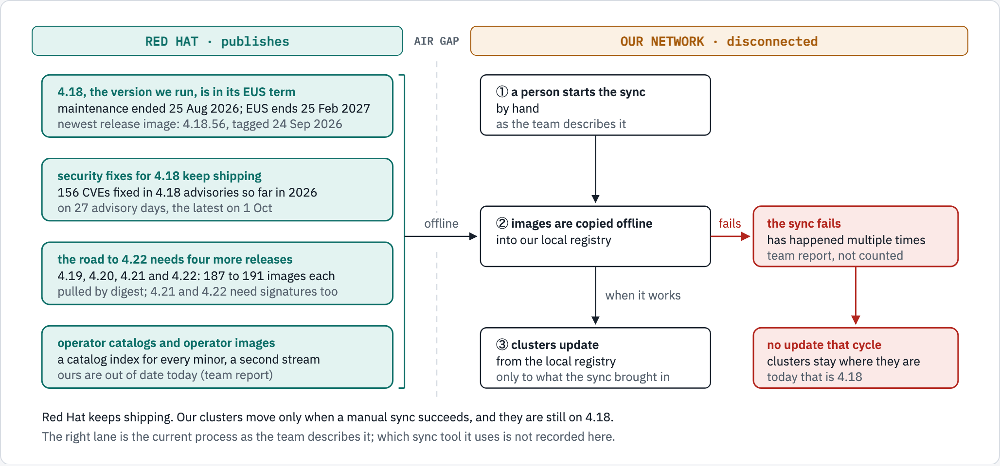
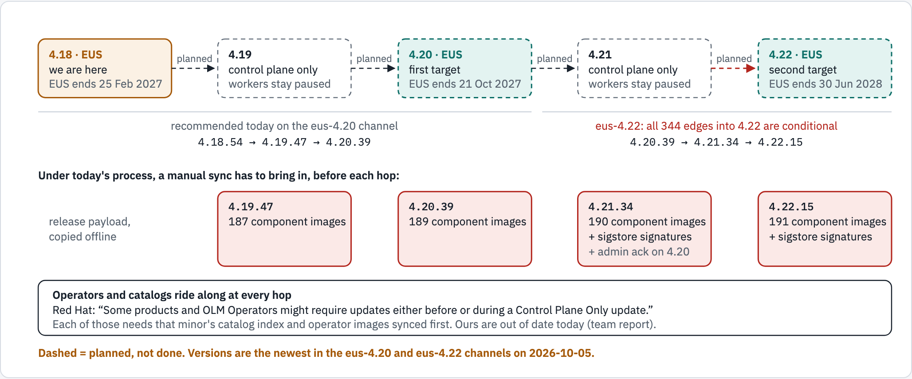
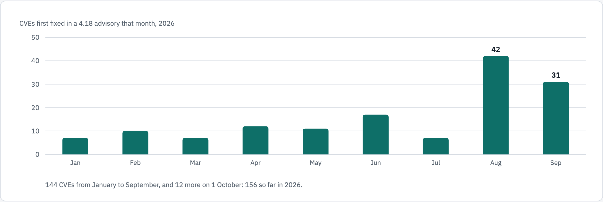

# Why our offline image sync cannot keep pace, and what replaces it

| | |
|---|---|
| Measured | 2026-10-05, against OpenShift 4.18 to 4.22 |
| Companion | [`SOLUTIONS.md`](SOLUTIONS.md) for the three steps, [`PREREQUISITES.md`](PREREQUISITES.md) for the new bastions and registries, [`DESIGN-DECISIONS.md`](DESIGN-DECISIONS.md) for the decisions, [`openshift-update-egress.html`](openshift-update-egress.html) for the full plan |

Our clusters run OpenShift 4.18 on the EUS channel and are well behind. Standard maintenance for
4.18 ended on 25 August 2026, and the plan is to move to 4.20 and then 4.22. Every step waits for
someone to copy images and catalogs into the local registry by hand. That sync has failed several
times, and Red Hat has replaced the tools it relies on.

**Refined (2026-10-07):** the current process now uses Ansible. The sync runs oc-mirror v2 from the playbooks in [`oc-mirror-ansible/`](../oc-mirror-ansible/README.md). A person still starts each run, so the gap described below narrows but does not close; the two designs under [Where we go instead](#where-we-go-instead) are the next steps.

## Every fix has to cross the gap by hand

<picture>
  <source media="(prefers-color-scheme: dark)" srcset="diagrams/disconnected-update-problem/today.dark.png">
  <source srcset="diagrams/disconnected-update-problem/today.light.png">
  
</picture>

*Red Hat still ships fixes for 4.18, and the road to 4.22 needs four more release payloads plus a
catalog for every minor. All of it reaches our network only through an offline sync that a person
starts by hand. When the sync fails, the clusters get no update that cycle. They are still on 4.18.*

```text
RED HAT publishes (measured)                    | AIR GAP |  OUR NETWORK, disconnected (as the team describes it)
- 4.18, the version we run, is in its EUS term  |         |  1. a person starts the sync, by hand
  maintenance ended 25 Aug 2026; EUS ends       |         |  2. images are copied offline into our local registry
  25 Feb 2027; newest image 4.18.56 (24 Sep)    | ------> |       fails -> the sync fails (multiple times; team
- security fixes for 4.18 keep shipping:        | offline |                report, not counted)
  156 CVEs fixed in 4.18 advisories in 2026,    |         |             -> no update that cycle; clusters stay
  on 27 advisory days, the latest on 1 Oct      |         |                where they are; today that is 4.18
- the road to 4.22 needs four more releases:    |         |  3. when it works: clusters update from the local
  4.19, 4.20, 4.21, 4.22, 187 to 191 images     |         |     registry, only to what the sync brought in
  each; 4.21 and 4.22 need signatures too       |         |
- operator catalogs and operator images: a      |         |
  catalog index for every minor; ours are out   |         |
  of date today (team report)                   |         |

Red Hat keeps shipping. Our clusters move only when a manual sync succeeds, and they are still on 4.18.
Refined 2026-10-07: the current process runs oc-mirror v2 from Ansible (oc-mirror-ansible/); a person still starts it.
```

## The road from 4.18 to 4.22

Between EUS releases the control plane passes through the odd minor while the workers stay paused.
That makes four release payloads, and under today's process each one needs a sync before its hop
can start.

<picture>
  <source media="(prefers-color-scheme: dark)" srcset="diagrams/disconnected-update-problem/road.dark.png">
  <source srcset="diagrams/disconnected-update-problem/road.light.png">
  
</picture>

*The plan is two EUS-to-EUS updates, which is four control-plane hops. Red Hat's update graph
recommends a path from 4.18 to 4.20 today. Every edge from 4.21 into 4.22 is conditional, meaning
it carries a declared risk the cluster has to evaluate. Under today's process each hop first needs
its release payload synced by hand; the hops into 4.21 and 4.22 also need sigstore signatures, and
leaving 4.20 needs an administrator acknowledgment that the signatures are mirrored.*

```text
4.18 EUS        ->  4.19              ->  4.20 EUS          ->  4.21              ->  4.22 EUS
we are here         control plane only    first target          control plane only    second target
EUS ends            workers stay paused   EUS ends              workers stay paused   EUS ends
25 Feb 2027                               21 Oct 2027                                 30 Jun 2028

recommended today on eus-4.20:            eus-4.22: all 344 edges into 4.22 are conditional:
4.18.54 -> 4.19.47 -> 4.20.39             4.20.39 -> 4.21.34 -> 4.22.15

Under today's process, a manual sync has to bring in, before each hop:
                    4.19.47               4.20.39               4.21.34               4.22.15
                    187 images            189 images            190 images            191 images
                                                                + sigstore signatures + sigstore signatures
                                                                + admin ack on 4.20

Operators and catalogs ride along at every hop. Red Hat: "Some products and OLM Operators might require
updates either before or during a Control Plane Only update." Each of those needs that minor's catalog
index and operator images synced first. Ours are out of date today (team report).

All hops are planned, not done. Versions are the newest in the eus-4.20 and eus-4.22 channels on 2026-10-05.
```

A conditional edge is not a blocked one. The six risks declared on the 4.21 to 4.22 edges include
one that applies to every cluster (kube-state-metrics crash loops when CronJobs set a time zone)
and others limited to multi-arch, s390x, Portworx or third-party CNI clusters. A disconnected
cluster sees those risks only if its local update service has current graph data.

## Fixes keep arriving for the version we run

<picture>
  <source media="(prefers-color-scheme: dark)" srcset="diagrams/disconnected-update-problem/fixes-per-month.dark.png">
  <source srcset="diagrams/disconnected-update-problem/fixes-per-month.light.png">
  
</picture>

*Red Hat's 4.18 advisories first fixed 156 CVEs in 2026, on 27 advisory days up to 1 October.
August and September carried 73 of them. Each fix reaches our clusters only after a sync brings in
the release that carries it. This measurement does not show why the later months are higher.*

| Month of 2026 | Advisory days | Advisories | CVEs first fixed |
|---|---:|---:|---:|
| January | 2 | 3 | 7 |
| February | 3 | 10 | 10 |
| March | 2 | 6 | 7 |
| April | 2 | 7 | 12 |
| May | 4 | 10 | 11 |
| June | 3 | 10 | 17 |
| July | 5 | 9 | 7 |
| August | 4 | 11 | 42 |
| September | 1 | 4 | 31 |
| October (to the 1st) | 1 | 4 | 12 |

An advisory day is a day on which a 4.18 advisory carried at least one CVE fix. A CVE is counted
once, in the month its first 4.18 fix shipped.

| Version on our road | CVEs first fixed in 2026 | Advisory days in 2026 | Newest release image | Support today |
|---|---:|---:|---|---|
| 4.18 (where we are) | 156 | 27 | 4.18.56, tagged 24 Sep | EUS term 1, to 25 Feb 2027 |
| 4.20 (first target) | 152 | 32 | 4.20.41, tagged 1 Oct | Maintenance, to 21 Apr 2027; EUS to 21 Oct 2027 |
| 4.22 (second target) | 159 | 16 | 4.22.17, tagged 1 Oct | Full support, to 31 Dec 2026; EUS to 30 Jun 2028 |

Counts are CVEs that Red Hat's security data API lists with a fix released under that product
version. 4.22 became generally available on 9 June 2026, so its count covers under four months.

The wider industry reports the same pressure. FIRST expects 2026 to end near 66,000 CVEs, and Help
Net Security attributes most of the rise to AI tools that hunt for flaws on their own. The Cloud
Security Alliance reports that of 1,596 AI-found flaws disclosed to open-source maintainers by
22 May 2026, 97 were confirmed patched. Those are industry figures. Nothing measured here ties a
specific OpenShift fix to AI discovery.

## The tools changed too

Whichever tool our sync uses today, Red Hat's 4.22 documentation has moved on from it. Staying
disconnected means migrating the process as well as running it.

| Was | In 4.22 | Source file |
|---|---|---|
| `oc adm release mirror` | "deprecated as of OpenShift Container Platform 4.22 and will be removed in a future release" | `snippets/oc-adm-release-mirror-depr.adoc` |
| oc-mirror plugin v1 | "The oc-mirror v1 plugin is deprecated." The docs say to "migrate to the supported v2 plugin" | `disconnected/installing-mirroring-disconnected.adoc` |
| `ImageSetConfiguration`, `mirror.openshift.io/v1alpha2` | `v2alpha1`. "You must manually update the configuration files before migration", and `storageConfig` must be removed | `modules/oc-mirror-migration-differences.adoc` |
| `ImageContentSourcePolicy` (ICSP) | Replaced by `ImageDigestMirrorSet` and `ImageTagMirrorSet` | `modules/oc-mirror-migration-differences.adoc` |
| Automatic pruning of old images (v1) | v2 "does not perform automatic pruning"; deleting images is a separate workflow | `modules/oc-mirror-v2-about.adoc` |
| Release images served from a mirror | "you must mirror the sigstore signatures" as well; otherwise the default image policy stops the node update. The policy is "active by default" from 4.21, and leaving 4.20 needs the `ack-4.20-sigstore-in-4.21` acknowledgment | `modules/nodes-sigstore-configure-cluster-policy.adoc`; 4.21 release notes; 4.20 `modules/update-preparing-ack-sigstore.adoc` |
| Operator dependencies | v2 "does not infer Group Version Kind (GVK) or bundle dependencies"; each dependent package has to be listed | `modules/oc-mirror-operator-catalog-filtering.adoc` |

Quotes are from `openshift/openshift-docs`, branch `enterprise-4.22`, commit `b9f51d8`, with
`enterprise-4.20` (`d51f4f2`) and `enterprise-4.21` (`acdecf2`) where named.

The refined current process ([`oc-mirror-ansible/`](../oc-mirror-ansible/README.md)) is built on oc-mirror v2 and `v2alpha1` ImageSetConfigurations: it generates IDMS and ITMS instead of ICSP, mirrors release signatures by default, never prunes, and lists every operator package explicitly.

## Where we go instead

The plan now has three steps (refined 2026-10-07). Step 1 modernises today's process with Ansible
and oc-mirror v2 and is built; it still means we mirror everything ourselves. Step 2, the team's
preferred position, is a direct enterprise proxy with only Red Hat's documented hosts allowed. Step 3,
the alternative, is a full Red Hat Quay registry on-prem, filled on a schedule. Steps 2 and 3 are
neither built nor approved. They are presented side by side in [`SOLUTIONS.md`](SOLUTIONS.md).

<picture>
  <source media="(prefers-color-scheme: dark)" srcset="diagrams/three-steps/three-steps.dark.png">
  <source srcset="diagrams/three-steps/three-steps.light.png">
  
</picture>

*Step 1 is built; Steps 2 and 3 are proposals. Every step opens the same Red Hat hosts at the
firewall; they differ in which machines use them: the mirroring bastions (Steps 1 and 3) or every node
(Step 2). No step needs two-headed DNS. Each still needs a plan for operator catalogs
([`DESIGN-DECISIONS.md`](DESIGN-DECISIONS.md), D2).*

We are not looking for two-headed DNS but for a sustainable way to update our clusters that keeps pace
with our growth. The disconnected setup we run was carried over from OpenShift 3.x, where it was the
sound choice because the proxy setup was a mess. OpenShift 4.x, and the major release that follows it,
are far more advanced: the cluster-wide proxy is Red Hat's documented, supported way for enterprise
customers to take updates and fixes as they ship, which is what operations and vulnerability management
need. That is the SME's recommendation in [`SOLUTIONS.md`](SOLUTIONS.md), Recommendation.

```text
            STEP 1: Ansible (built)        STEP 2: enterprise proxy (proposed)   STEP 3: Quay on-prem (proposed)
INSIDE      OpenShift cluster              OpenShift cluster                     OpenShift cluster
            no egress; IDMS/ITMS per run   Proxy CR: CVO, CRI-O, OLM             no egress; pulls from Quay
            graph from a local OSUS        workloads blocked from the proxy      local OSUS: required
              ^ images, graph data           | images, graph, signatures           ^ images, graph data
            mirror registries lab/DC1/DC2  enterprise proxy                      Red Hat Quay, HA, per datacenter
              ^ push                       allowlist: Red Hat hosts only           ^ push
            bastion per DC, by hand        (no mirror host, registry or OSUS)    bastion per DC, systemd timer
            Ansible + oc-mirror v2 + Vault                                       runs the Step 1 playbooks
EGRESS        | one host, through the proxy  | every node, through the proxy       | one host, through the proxy
RED HAT     quay.io, registry.redhat.io, api.openshift.com, mirror.openshift.com: the same hosts for every step
```

## What the proposal removes, and what stays

Neither design makes the remaining work go away. The updates still have to be run, the clusters
still have to be pointed at an update service and a registry, and the operator catalog still has to
be gated through GitOps so that only approved items are exposed. That work exists today and in both
designs.

| Stays in every option | Today | Preferred: proxy | Alternative: Quay on-prem |
|---|---|---|---|
| The updates themselves | 4.18 to 4.20 to 4.22, four control-plane hops | The same hops | The same hops |
| Update service | A local service whose graph data has to be refreshed | Point the cluster at Red Hat's service: clear `spec.upstream` and set the channel | A local OSUS; oc-mirror v2 builds its graph image on each run |
| Cluster registry configuration | Mirror sets point at the local registry | Red Hat credentials in the pull secret, `allowedRegistries`, and the mirror sets removed after the first connected update | New IDMS and ITMS pointing at Quay, generated by oc-mirror v2 |
| Catalog gating through GitOps | Needed | Git owns every CatalogSource and Subscription; an admission policy enforces the approved list | The same, with the filtered catalog built by oc-mirror v2 |

What the proposal changes is the part that is broken today: copying images and catalogs across by
hand.

| Removed or automated | Today | Preferred: proxy | Alternative: Quay on-prem |
|---|---|---|---|
| Image sync | Refined: oc-mirror v2 run from Ansible (`oc-mirror-ansible/`), still started by a person | Gone. Each node pulls through the proxy | A scheduled oc-mirror v2 job |
| Catalog sync | Refined: the Ansible catalog playbook, still started by a person; catalogs stay out of date until it runs | Gone. Catalogs and operator images come from `registry.redhat.io` | The same scheduled job; every dependency listed by hand |
| A failed sync | No update that cycle. It has happened multiple times | No sync to fail. A proxy outage stops pulls, so the proxy has to be highly available | Still possible. Red Hat lists open oc-mirror failure modes in KB 7130341, 7139982 and 7128745 |
| Tooling migration | Done: oc-mirror v2 and `v2alpha1`, in `oc-mirror-ansible/` | No mirroring tool to maintain | Start on oc-mirror v2 |
| Release signatures | Have to be mirrored, with an acknowledgment before 4.21 | Checked against Red Hat directly once the mirror sets are gone | oc-mirror v2 mirrors signatures by default |
| Two-headed DNS | Not applicable | Not needed. Nodes resolve only the proxy | Not needed. oc-mirror v2 uses the proxy |
| What we run | Today three old mirror registries 1.x (over three years old); refined: two mirroring bastions and three new mirror registries 2.0.x on RHEL 9 ([`PREREQUISITES.md`](PREREQUISITES.md)), Ansible run by hand | A highly available proxy | Highly available Quay per datacenter, the two bastions, OSUS, and the proxy for the bastions |
| What it costs to get there | Five new RHEL 9 hosts and a cutover of every cluster to its new registry | Security's approval of the change, taken to it on the threat model with one condition, that applications cannot use the proxy by default; one reboot of every node | A Consulting engagement, a Quay specialist, and a new registry to size and operate |

The team's assessment is that our backlog of fixes and our limits on upgrading come from this
process, not from OpenShift. The measurements are consistent with that: Red Hat has shipped 156
fixes for 4.18 this year, and its update graph recommends a path to 4.20 from every 4.18 release.
What is missing is the content inside our network.

The rows on DNS, signatures, catalogs and the Quay failure KBs come from the plan's research of
2026-09-25. That research found no Red Hat document that requires Consulting for Quay; bringing
them in is our choice.

## Still to settle

- We mirror into three old mirror registries for Red Hat OpenShift 1.x, each more than three years
  old (team report, 2026-10-07). They are replaced, not upgraded: two mirroring bastions and three new 2.0.x registries
  on RHEL 9 ([`PREREQUISITES.md`](PREREQUISITES.md)). Which datacenter holds the lab, and how many
  clusters each production registry serves, are still to confirm.
- The platform owner decides, and the decision is the proxy approach. The change goes to security on
  the threat model ([`enterprise-proxy/THREAT-MODEL.md`](enterprise-proxy/THREAT-MODEL.md)) with
  one condition: applications cannot use the proxy by default. Security has not yet approved it.
- Order of work: the cluster-wide proxy is a documented configuration on 4.18. Enabling it before
  the updates would let the hops to 4.20 and 4.22 run without any sync. Red Hat Support should
  confirm that removing the mirror sets also removes the signature acknowledgment before 4.21.
- The Red Hat Consulting engagement and the Quay specialist for the alternative are not arranged.
- This document does not record which 4.18 release each cluster is on or how many times the sync
  has failed. Those two facts would make the case stronger. The sync tool is recorded: since
  2026-10-07 the current process runs oc-mirror v2 from Ansible ([`oc-mirror-ansible/`](../oc-mirror-ansible/README.md)).
- The plan also holds a third design that sits between these two: update graph and signatures from
  Red Hat through the proxy, images from our mirror registries. Red Hat does not document that
  combination.

## How this was measured

All measurements were taken on 2026-10-05.

```sh
# support phases for 4.18 to 4.22
curl 'https://access.redhat.com/product-life-cycles/api/v1/products?name=Openshift%20Container%20Platform%204'

# release images per minor, with push timestamps (repeat for 4.18, 4.20, 4.22)
curl 'https://quay.io/api/v1/repository/openshift-release-dev/ocp-release/tag/?filter_tag_name=like:4.18.%25-x86_64&limit=100&onlyActiveTags=true'

# update graph: recommended and conditional edges (repeat for eus-4.22)
curl -H 'Accept: application/json' 'https://api.openshift.com/api/upgrades_info/v1/graph?channel=eus-4.20&arch=amd64'

# component images in one release: digests in the Images section (4.19.47, 4.20.39, 4.21.34, 4.22.15)
curl https://mirror.openshift.com/pub/openshift-v4/x86_64/clients/ocp/4.19.47/release.txt

# CVEs with a fix released under one product version (repeat for 4.20 and 4.22)
curl 'https://access.redhat.com/hydra/rest/securitydata/cve.json?product=Red%20Hat%20OpenShift%20Container%20Platform%204.18&per_page=5000'
# then, for each CVE, the release_date and advisory of every matching entry in affected_release
curl https://access.redhat.com/hydra/rest/securitydata/cve/<CVE>.json

# documentation quotes
git clone --depth 1 -b enterprise-4.22 https://github.com/openshift/openshift-docs.git   # commit b9f51d8
```

Industry sources:

- Help Net Security, 15 June 2026, "AI vulnerability discovery is pushing 2026 CVEs toward 66,000":
  <https://www.helpnetsecurity.com/2026/06/15/first-2026-cve-forecast/>
- Cloud Security Alliance AI Safety Initiative, 8 June 2026, "Project Glasswing: AI Discovery
  Outpaces Open Source Patching Capacity":
  <https://labs.cloudsecurityalliance.org/research/csa-research-note-glasswing-ai-vuln-patching-deficit-2026060/>

## Diagram sources

The first three figures are drawn in [`diagrams/disconnected-update-problem/source.html`](diagrams/disconnected-update-problem/source.html)
and rendered to the PNGs beside it with [diagram-kit](https://github.com/ephico2real2/diagram-kit) (MPL-2.0), which
writes them only when its checks pass:

```sh
# once: the kit, pinned, and its Chromium
python3 -m venv .venv
.venv/bin/pip install "diagram-kit @ git+https://github.com/ephico2real2/diagram-kit@v0.2.4"
.venv/bin/playwright install chromium

.venv/bin/diagram-render \
  docs/diagrams/disconnected-update-problem/source.html \
  docs/diagrams/disconnected-update-problem \
  today,road,fixes-per-month
```

The three-steps figure is drawn in [`diagrams/three-steps/source.html`](diagrams/three-steps/source.html);
its render command is in [`SOLUTIONS.md`](SOLUTIONS.md), Diagram sources.

A figure, its text twin in this document and the page change together.
