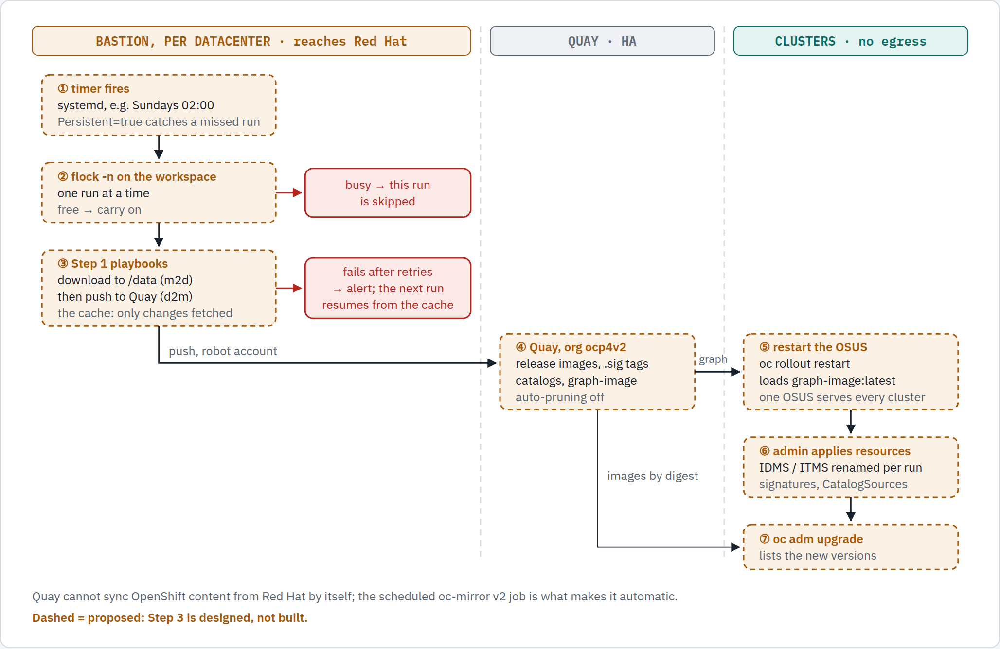
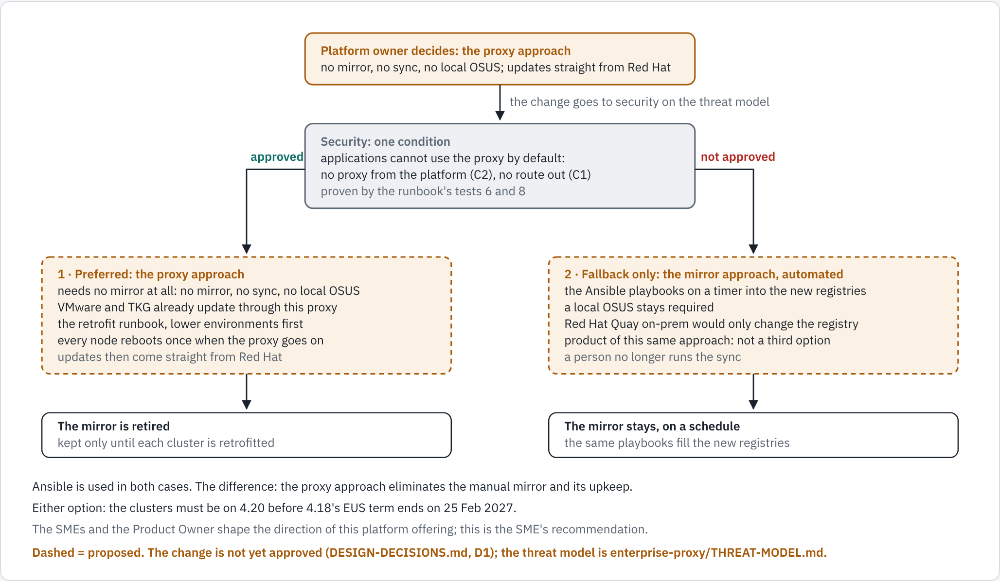

# Keeping our disconnected OpenShift clusters current: three solutions

| | |
|---|---|
| Date | 2026-10-07 |
| For | Platform team, security, management |
| Status | Step 1 is built. Steps 2 and 3 are proposals: no decision is ratified, and both need security approval |
| Prerequisites | Two mirroring bastions and three registries on RHEL 9: [`PREREQUISITES.md`](PREREQUISITES.md) |
| Technical detail | Step 1: [`oc-mirror-ansible/`](../oc-mirror-ansible/README.md). Step 2: [`enterprise-proxy/`](enterprise-proxy/README.md). Step 3: [`quay-onprem/`](quay-onprem/README.md). The problem: [`PROBLEM-STATEMENT.md`](PROBLEM-STATEMENT.md). The decisions: [`DESIGN-DECISIONS.md`](DESIGN-DECISIONS.md) |

## Summary

Our clusters run OpenShift 4.18.17 on the EUS channel and are well behind. Every update starts with
someone copying images and catalogs into our registry, and that copy has failed several times. The
plan is to move to 4.20 and then 4.22, which needs four release payloads plus catalogs for each minor.

This document presents three steps. They are not mutually exclusive: Step 1 is done and keeps us
moving now, and either Step 2 or Step 3 is the long-term design.

| # | What it is | Who copies the content | Cluster egress | Status |
|---|---|---|---|---|
| **1** | Our current process, modernised with Ansible and oc-mirror v2 | We do, from the mirroring bastion in each datacenter, each time we update | None | **Done**: playbooks and guides in Git |
| **2** | Clusters reach Red Hat through the enterprise proxy | Nobody: the cluster pulls what it needs | Red Hat hosts only, through the proxy | Runbook written; needs security approval |
| **3** | A full Red Hat Quay registry on-prem, filled on a schedule | A scheduled job, not a person | None | Design written; needs a Quay subscription and a build team |

<picture>
  <source media="(prefers-color-scheme: dark)" srcset="diagrams/three-steps/three-steps.dark.png">
  <source srcset="diagrams/three-steps/three-steps.light.png">
  
</picture>

*Step 1 is built; Steps 2 and 3 are proposals. All three open the same Red Hat hosts; they differ
in which machines use them. No step needs two-headed DNS.*

```text
            STEP 1 (built)                 STEP 2 (proposed, preferred)          STEP 3 (proposed, alternative)
INSIDE      cluster: no egress, local OSUS cluster: Proxy CR, workloads blocked   cluster: no egress, local OSUS
            mirror registries: lab,DC1,DC2 enterprise proxy, Red Hat hosts only  Red Hat Quay, HA, per datacenter
            bastion per datacenter, by hand no mirror host, registry or OSUS     bastion per datacenter, timer
EGRESS      one host, through the proxy    every node, through the proxy         one host, through the proxy
RED HAT     quay.io, registry.redhat.io, api.openshift.com, mirror.openshift.com
```

**The team's position (2026-10-05):** Step 2 preferred, Step 3 as the alternative. The choice turns on
one security answer: may cluster nodes reach Red Hat's hosts through the proxy?

## Where we are

| Fact | Value |
|---|---|
| Version and channel | 4.18.17 on `eus-4.18` |
| 4.18 support | Maintenance ended 25 August 2026; the EUS term ends 25 February 2027 |
| Target | 4.20 (EUS), then 4.22 (EUS). 4.22 reached GA on 9 June 2026 |
| Road | Control-plane-only EUS updates: 4.18 → 4.19 → 4.20, then 4.20 → 4.21 → 4.22 |
| Registries today | Three old **mirror registries for Red Hat OpenShift** 1.x (the trimmed-down, single-host Quay), each more than three years old: 1.0 to 1.3.x, Quay 3.6 to 3.8 |
| What each hop needs in a disconnected cluster | Its release payload (about 190 images), the update graph, the release signatures and, from 4.21, sigstore signatures; plus an operator catalog per minor |

Measurements and sources are in [`PROBLEM-STATEMENT.md`](PROBLEM-STATEMENT.md).

## Before any step: new hosts

The three old registries are replaced, not upgraded. Red Hat now ships mirror registry 2.0.x (Quay
3.12, SQLite instead of PostgreSQL) and documents an in-place upgrade only from 1.3; ours are older. We build new hosts
instead, all on RHEL 9 (RHEL 10 is not yet supported for the mirror registry or `oc-mirror`):

- **A mirroring bastion in each datacenter.** Every Ansible and oc-mirror command runs there, and
  only the bastions reach Red Hat, through the enterprise proxy.
- **Three registries:** a lab registry, where new content is tried first, and one production
  registry in each datacenter. Each is a fresh mirror registry 2.0.x install, filled again from
  Red Hat by oc-mirror v2.
- **The old registries** serve the clusters until each cluster has switched to its new registry
  (lab to lab, DC1 to DC1, DC2 to DC2), then they are retired. Meanwhile the bastions can also push v2 content into them, or into any existing
  registry, on a new path (e.g. `ocp4v2`), never into the path oc-mirror v1 filled.

Red Hat discourages using one mirror registry for several clusters and asks for mirror registries
to be highly available. If a production registry serves several clusters, Step 3 (full Quay) is
the long-term answer. Hosts, sizing, flows and the cluster cutover: [`PREREQUISITES.md`](PREREQUISITES.md).

<picture>
  <source media="(prefers-color-scheme: dark)" srcset="diagrams/prerequisites/topology.dark.png">
  <source srcset="diagrams/prerequisites/topology.light.png">
  
</picture>

*Proposed layout: the bastions and registries are not built yet.*

```text
DC1: mirror-bastion-dc1 --push 8443--> registry-lab (lab clusters), registry-dc1 (production DC1)
DC2: mirror-bastion-dc2 --push 8443--> registry-dc2 (production DC2)
both bastions --443 via the enterprise proxy--> Red Hat; the three old 1.x registries may take pushes on a new path
(e.g. ocp4v2, never the v1 path) until they are retired after cutover
```

## Step 1: our current process, modernised with Ansible

**What it is.** The same model as today, the mirroring bastion in each datacenter copies Red Hat
content into the lab registry and that datacenter's production registry before each update, but run by Ansible playbooks around oc-mirror v2, the tool Red Hat documents for
disconnected mirroring from 4.18 to 4.22.

<picture>
  <source media="(prefers-color-scheme: dark)" srcset="../oc-mirror-ansible/docs/diagrams/mirroring/run-flow.dark.png">
  <source srcset="../oc-mirror-ansible/docs/diagrams/mirroring/run-flow.light.png">
  
</picture>

*One Step 1 release run, as the playbooks and guide do it today. Red boxes are what stops a run and
what fixes it.*

```text
MIRRORING BASTION                                       CLUSTER, change window
1 ansible-playbook in tmux, Vault password              7 registry login + CA trust
2 check pull secret (quay.io, registry.redhat.io)       8 apply cluster-resources (IDMS/ITMS renamed per run,
3 dry-run: mapping.txt; fix anything in missing.txt       signature ConfigMap, CatalogSources)
4 download (m2d) + cache, push (d2m) per registry   9 Update Service, spec.upstream, restart on new graph
5 auth file removed, even on failure                    10 oc adm upgrade lists the target
6 verify tags, .sig tags, cluster-resources/  --hand over-->
```

**What changed compared with the manual process:**

- **Repeatable runs:** the release images, the update graph and the Update Service operator come
  from one playbook; operator catalogs from a second, one catalog group and OpenShift version
  (`v4.18`, `v4.20`, …) per run.
- **Secrets in Ansible Vault:** the Red Hat pull secret and the registry login are encrypted at rest
  and never written in plain text to the playbook folder.
- **The corporate proxy on the bastions only:** the clusters stay disconnected.
- **Fewer failed syncs:** a dry-run first to size the run, retries and longer timeouts for the
  failures we saw, and a persistent cache: each bastion downloads to disk once (oc-mirror's
  mirror-to-disk), so a failed run resumes and later runs fetch only what changed, then pushes the
  same archive into lab and production (disk-to-mirror).
- **The whole road at once:** the playbooks can mirror 4.18 → 4.20 → 4.22 back to back, before any
  cluster updates, using the shortest path in each EUS channel.
- **A local OpenShift Update Service:** the clusters see the same recommended update paths as a
  connected cluster.
- **Signatures kept:** release runs keep the sigstore signatures that 4.21 and later require.
- **Step-by-step guides:** written for someone doing it the first time.

**What it doesn't change.** We still mirror everything ourselves. Each update waits until a person
has run the sync and applied its output to the cluster. When a sync fails, the update slips. The
catalog list has to be maintained by hand per version.

**Use it for:** getting off 4.18 now, whichever long-term step is chosen. It is also the engine of
Step 3, and the fallback if Step 2 is not approved.

Detail: [`oc-mirror-ansible/README.md`](../oc-mirror-ansible/README.md), with the release and catalog guides.

## Step 2: the clusters reach Red Hat through the enterprise proxy

**What it is.** Each cluster's built-in proxy setting (the `Proxy` resource) sends the platform's
traffic to our enterprise proxy, which allows only the Red Hat hosts in Red Hat's firewall
documentation. The cluster then gets images, the update graph, signatures and operator catalogs the
way a connected cluster does. There is no mirror, no sync and no local Update Service.

**How an existing cluster gets there.** The runbook converts a running disconnected cluster in ten
phases, ordered so that changes that touch no nodes go first:

1. Approve the host list, set up the firewall and an HA proxy, and get Red Hat credentials.
2. Back up every object the runbook changes; inventory the internal services the platform uses.
3. Add Red Hat's pull secret to the cluster's global pull secret. No node effect.
4. Limit which registries and repositories any pod may pull from. CRI-O reload only.
5. Turn on the cluster-wide proxy. **Every node drains and reboots once**: a maintenance window.
6. Block application pods from the proxy, so only platform components use it.
7. Point update checks back at Red Hat.
8. Move operator subscriptions to Red Hat's catalog.
9. Run one update with the old mirror still in place, as a safety net.
10. Remove the mirror configuration and the local Update Service. Another drain.

<picture>
  <source media="(prefers-color-scheme: dark)" srcset="diagrams/three-steps/retrofit.dark.png">
  <source srcset="diagrams/three-steps/retrofit.light.png">
  
</picture>

*The proposed retrofit, phase by phase, with what each phase does to the nodes. The numbered list
above is the same order.*

**What going direct gives us, beyond removing the sync:**

| Advantage | Why |
|---|---|
| Updates arrive when Red Hat ships them | Z-streams for the newest minor ship weekly. A cluster can take a security fix the day it is published, not after a mirror run has succeeded |
| Live upgrade guidance | The cluster reads its update recommendations from `api.openshift.com`, including Red Hat's known-issue risks on conditional upgrade paths, as soon as they are published. A local Update Service only knows what the last sync brought |
| No signature mirroring | From 4.21 release images must be signed. A connected cluster reads the signatures from Red Hat; a disconnected one needs them mirrored, plus the `ack-4.20-sigstore-in-4.21` acknowledgment before 4.21 |
| Full, current operator catalogs | Any approved operator can be installed or updated without mirroring it first. oc-mirror v2 does not infer an operator's dependencies, so a mirrored catalog needs each one listed by hand |
| Less to run and size | No mirror registries to keep highly available, no 2 TB caches, no oc-mirror version to track, none of its known failure modes (Red Hat KBs 7130341, 7139982, 7128745) |
| Fewer node drains later | No IDMS/ITMS/ICSP to create or delete at each cutover; deleting them drains the nodes |
| Red Hat's standard configuration | The connected cluster-wide proxy is the documented, most common setup, so support cases start from known ground |
| Optional, if security agrees | Insights recommendations and telemetry give Red Hat Support proactive alerts and cluster data. Off unless enabled; updates do not need them |

The costs are in the runbook: an HA proxy, security approval for node egress, one reboot of every
node when the proxy goes on, and one drain when the mirror objects are removed.

**Does the cluster-wide proxy open every namespace to the internet? No.** Red Hat, in the 4.18 and
4.22 docs alike: "The system-wide proxy affects system components only, not user workloads"
(`networking/configuring_network_settings/enable-cluster-wide-proxy.adoc`). Application pods get no
proxy settings, and the firewall still lets nothing out directly. Even platform components reach
only what the proxy allows, and our allowlist is Red Hat's documented hosts and nothing else.

Three gaps remain, and the runbook closes each one:

| Gap | Why it exists | Control (runbook phase) |
|---|---|---|
| A pod sets `HTTPS_PROXY` itself | Pod traffic leaves with the node's IP, so the proxy cannot tell a pod from a platform component | EgressFirewall in every application namespace denying the proxy's address, also in the project template for new namespaces (phase 5) |
| Operators installed from OperatorHub get the proxy | Red Hat: OLM operators "inherit the cluster-wide proxy settings on their deployments", in whatever namespace they run | They reach only allowlisted hosts; any namespace that needs them is named in the security sign-off |
| Any pod's image can come from `quay.io` | CRI-O pulls images for every pod through the node's proxy setting | `allowedRegistries` lists repositories, not whole registries (phase 3) |

The runbook's verification table proves it on a live cluster: a test pod in an application
namespace has no proxy variables, cannot reach the proxy, cannot go out directly, and cannot pull
an image from outside the allowlist.

**No two-headed DNS.** The proxy resolves Red Hat's names; nodes resolve only internal names.
Internal DNS stays as it is.

**What we run:** an HA egress proxy with an allowlist, and the firewall rule that only the proxy may
go out. Nothing new inside the clusters.

**Risks and how they are handled:**

| Risk | Handling |
|---|---|
| Proxy outage stops image pulls | Run the proxy highly available, as a mirror registry would have to be |
| Red Hat changes hostnames | Track the firewall documentation; alert on proxy denies |
| An internal service missed from `noProxy` breaks a platform feature | Inventory before the proxy goes on; test in lower environments first |
| Telemetry sends cluster data to Red Hat | Leave it off unless security decides otherwise; updates don't need it |
| A TLS-intercepting proxy | Exempt Red Hat hosts until Red Hat Support confirms the position |

**Needs:** security approval of node egress to the listed hosts; answers on telemetry and TLS
interception; a Red Hat Support case for the open questions in the runbook.

Detail: [`enterprise-proxy/README.md`](enterprise-proxy/README.md).

## Step 3: a full Red Hat Quay registry on-prem

**What it is.** A highly available Red Hat Quay replaces the production mirror registries, one per
datacenter. The clusters keep no
egress. The Step 1 playbooks fill Quay on a schedule from the mirroring bastion in each datacenter, the only machines that
reaches Red Hat through the proxy. The clusters pull everything from Quay.

**Can Quay sync from Red Hat by itself?** Not for OpenShift. Quay's repository mirroring copies
tags one repository at a time, organisation mirroring needs a Quay or Harbor source, and the proxy
cache fetches only what is pulled. None of them understands release payloads, catalogs, signatures
or the update graph, and repository mirroring drops the signatures 4.21 needs. **"Automatic" here
means a scheduled oc-mirror v2 job** (a systemd timer on each bastion running the Step 1
playbooks), which is what Red Hat documents.

**The OpenShift Update Service is required.** The clusters cannot reach Red Hat's update service,
so a local one serves the update graph from the graph image that each scheduled run puts in Quay.
One instance can serve every cluster. It must be restarted after each sync to load the new graph.

<picture>
  <source media="(prefers-color-scheme: dark)" srcset="diagrams/three-steps/quay-sync.dark.png">
  <source srcset="diagrams/three-steps/quay-sync.light.png">
  
</picture>

*One run of the proposed Step 3 schedule, from a bastion's timer to the clusters.*

```text
BASTION (per datacenter)            QUAY                          CLUSTERS
1 timer fires                       4 org ocp4v2: release, .sig,    5 restart the OSUS (new graph)
2 flock: busy -> skip this run        catalogs, graph-image       6 admin applies cluster-resources
3 Step 1 playbooks; fail -> alert,                                7 oc adm upgrade lists new versions
  next run resumes (cache) --push-->
```

**Where Quay runs:** not on a cluster it serves. Either the Quay Operator on a separate infra or hub
cluster, with OpenShift Data Foundation or S3 storage, or standalone Quay on three or more RHEL hosts.

**What we run:** HA Quay with its database, Redis and object storage; Clair for image scanning; the
bastions and their timers; the Update Service.

**Needs:** a Quay subscription (OpenShift Platform Plus reportedly includes it); a platform for it;
the team's chosen build partner (Red Hat Consulting and a Quay specialist; no Red Hat document
requires Consulting); storage sized from the Step 1 dry-runs.

Detail: [`quay-onprem/README.md`](quay-onprem/README.md).

## The three steps side by side

| | Step 1: Ansible, current model | Step 2: enterprise proxy | Step 3: Quay on-prem |
|---|---|---|---|
| Cluster egress | None | Red Hat hosts, through the proxy | None |
| Who copies content | A person runs the playbooks before each update | Nobody | A scheduled job |
| Update delayed by a failed sync | Yes | No sync to fail | The next scheduled run catches up |
| Local Update Service | Yes | No | Yes, required |
| Mirroring bastions | One per datacenter | Only to run the retrofit and fill the lab | One per datacenter, on a timer |
| Registries | Three new mirror registries (lab, DC1, DC2) | Lab registry; production registries until each cluster is retrofitted | HA Quay per datacenter; the lab keeps its mirror registry |
| Two-headed DNS | No | No | No |
| One-off node impact | None beyond today | One reboot (proxy), one drain (mirror removal) | Mirror config changes as today |
| Security approval | Mirror host to Red Hat (as today) | Cluster nodes to Red Hat hosts | Mirror host to Red Hat |
| New things to run | Two bastions and three mirror registries on RHEL 9 | HA proxy with allowlist | HA Quay, storage, Clair, bastion timers, Update Service |
| Operator catalogs | Mirrored per version, list kept by hand | Red Hat's catalog, or a filtered one | Mirrored per version on a schedule |
| Ready to use | Now | After approval and one window per cluster | After a Quay build |

## Recommendation

<picture>
  <source media="(prefers-color-scheme: dark)" srcset="diagrams/three-steps/decision.dark.png">
  <source srcset="diagrams/three-steps/decision.light.png">
  
</picture>

*Proposed decision flow. Only Step 1's playbooks exist today.*

```text
Now: Step 1 takes the clusters to 4.20 (4.18 EUS ends 25 Feb 2027)
  -> security: may cluster nodes reach Red Hat's hosts through the proxy?
       yes -> Step 2 runbook, lower environments first   (Step 1 stays as the fallback)
       no  -> Step 3, build Red Hat Quay on-prem          (Step 1 becomes its engine)
```

1. **First:** build the two bastions and three registries ([`PREREQUISITES.md`](PREREQUISITES.md)).
2. **Now:** use Step 1 to take the clusters from 4.18.17 to 4.20, mirroring the road back to back
   before any cluster updates. 4.18's EUS term ends on 25 February 2027, so this cannot wait for
   Steps 2 or 3.
3. **In parallel:** take Step 2 to security. It is the team's preferred design, uses only documented
   configuration, and removes the sync entirely.
4. **If security approves node egress:** run the Step 2 runbook in lower environments, then
   production, one cluster per window.
5. **If security does not approve it:** build Step 3 and move the Step 1 playbooks onto its
   schedule.

## Decisions needed

| Decision | From | Blocks |
|---|---|---|
| May cluster nodes reach Red Hat's hosts through the proxy? | Security | Step 2 or Step 3 |
| Telemetry and Insights on or off? | Security | Step 2 allowlist and pull secret |
| Will the proxy intercept TLS to Red Hat hosts? | Network team, Red Hat Support | Step 2 proxy configuration |
| Filtered or stock operator catalog? | Platform team | Step 2 catalog phase, Step 3 catalog runs |
| Quay subscription, platform and build partner | Management | Step 3 |
| Five RHEL 9 hosts, DNS names, internal-CA certificates and firewall flows | Infrastructure, network teams | Everything ([`PREREQUISITES.md`](PREREQUISITES.md)) |
| Which datacenter holds the lab; how many clusters each production registry serves | Platform team | Registry layout; whether Step 3 is needed |
| Monthly z-stream window | Platform team | All steps |

## Diagram sources

The figures are drawn in [`diagrams/three-steps/source.html`](diagrams/three-steps/source.html) and
[`../oc-mirror-ansible/docs/diagrams/mirroring/source.html`](../oc-mirror-ansible/docs/diagrams/mirroring/source.html),
and rendered to the PNGs beside them with [diagram-kit](https://github.com/ephico2real2/diagram-kit):

```sh
# once: see PROBLEM-STATEMENT.md, Diagram sources, for installing diagram-kit into .venv
.venv/bin/diagram-render docs/diagrams/three-steps/source.html docs/diagrams/three-steps \
  three-steps,decision,retrofit,quay-sync
.venv/bin/diagram-render oc-mirror-ansible/docs/diagrams/mirroring/source.html oc-mirror-ansible/docs/diagrams/mirroring \
  run-flow,network-routes,upgrade-path-runs
```

A figure, its text twin and its page change together. The Word copy embeds the light PNGs.
