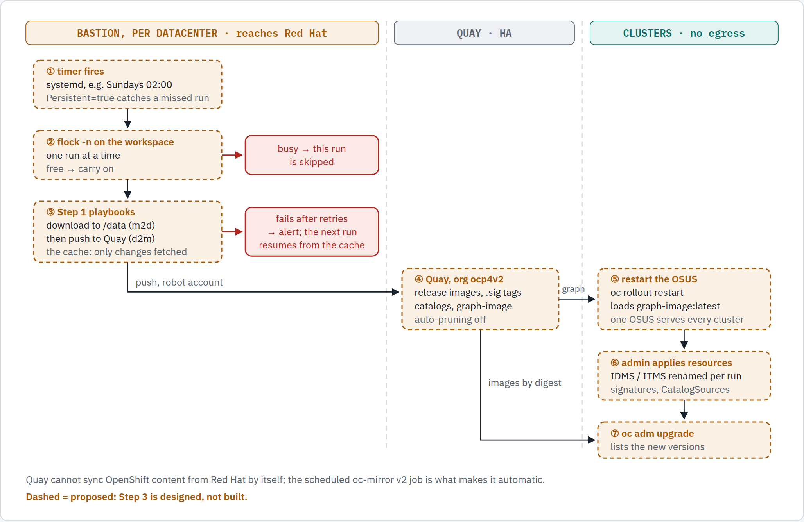

# Step 3, the fallback's Quay variant: Red Hat Quay on-prem

| | |
|---|---|
| Status | The fallback only, and only its registry-product choice: the mirror approach automated, with Red Hat Quay instead of the mirror registries. Not a third option ([`SOLUTIONS.md`](../SOLUTIONS.md), Recommendation). Not built or approved |
| Researched | 2026-10-07, against `quay/quay-docs` branch `redhat-3.18` and `openshift/openshift-docs` branches `enterprise-4.22` and `enterprise-4.18` |
| Builds on | Step 1, [`oc-mirror-ansible/`](../../oc-mirror-ansible/README.md), which fills the registry |
| Hosts | The mirroring bastions and datacenter layout in [`PREREQUISITES.md`](../PREREQUISITES.md); full Quay would replace the two production mirror registries |
| In the design docs | Option 2, as documented ([`DESIGN-DECISIONS.md`](../DESIGN-DECISIONS.md)) |

Step 3 replaces the production mirror registries ([`PREREQUISITES.md`](../PREREQUISITES.md)) with a highly available Red Hat Quay. The clusters keep **no egress**:
they pull every image from Quay and their update graph from a local OpenShift Update Service. Quay
is filled by the step 1 oc-mirror v2 playbooks, run **on a schedule** from one mirror host that alone
reaches Red Hat through the proxy.

**Quay cannot keep OpenShift releases and catalogs in sync from Red Hat by itself.** Its own sync
features copy tags or cache pulls; none of them understands release payloads, catalog contents,
signatures or update graph data. A scheduled oc-mirror v2 job is what makes it "automatic".

## How it fits together

```text
RED HAT        quay.io, registry.redhat.io, api.openshift.com (graph data), registry.access.redhat.com
                  ^  only the mirror host, through the enterprise proxy
MIRROR HOST    systemd timer -> step 1 Ansible playbooks -> oc-mirror v2
                  | push (robot account)
QUAY (HA)      on an infra cluster (Quay Operator + ODF) or 3+ RHEL hosts; Clair scans what lands
                  ^ pull through IDMS / ITMS, CatalogSources            ^ graph data image + release images
CLUSTERS       no egress; pull secret for Quay; trust Quay's CA     OpenShift Update Service (required)
```

## Can Quay sync from Red Hat by itself?

| Mechanism | What it does | OpenShift releases and catalogs? | Signatures | Source |
|---|---|---|---|---|
| Repository mirroring | Copies tags matching a glob from one external repository, every 24 h by default | No: one repository at a time, no knowledge of release payloads, catalog `relatedImages` or graph data | Not mirrored | `modules/mirroring-creating-repository.adoc`, `mirroring-using.adoc` |
| Organization mirroring (3.18) | Mirrors a whole organization | No: the source must be **Quay or Harbor**, not `registry.redhat.io` | "OCI Referrers API artifacts, such as Cosign signatures and SBOMs, are not currently mirrored" | `modules/config-ui-mirroring-organization.adoc`, `mirroring-using.adoc` |
| Proxy cache organization | Pull-through cache: fetches from upstream when someone pulls | No: nothing is fetched until something pulls it, so a disconnected cluster finds nothing new | Only what is pulled | `modules/proxy-cache-*.adoc` |
| **oc-mirror v2** (step 1 playbooks) | Mirrors release payloads, catalogs, graph data and signatures; writes IDMS/ITMS/CatalogSources | **Yes**, and it is what Red Hat documents for disconnected mirroring | Mirrored by default | openshift-docs `modules/oc-mirror-v2-prerequisites.adoc`, `oc-mirror-signature-mirroring.adoc` |

Repository mirroring stays useful for a handful of ordinary images that aren't part of a release or
catalog (base images, tools). Never use it for release images: it drops the signatures that clusters
need from 4.21.

## Where Quay runs

- **Not on a cluster it serves.** That cluster would need Quay to install and update itself. Red Hat:
  "To run a production-grade registry service on such a cluster, you must create a separate registry
  deployment to install the first cluster" (quay-docs `modules/arch-mirror-registry.adoc`).
- **Choose one:**
  - **Quay Operator on a separate infra or hub cluster** (recommended if one exists).
  - **Standalone Quay on three or more RHEL hosts** with podman, plus an HA database, load balancer
    and object storage.
- **Not the "mirror registry for Red Hat OpenShift":** it "is not intended to be a substitute for a
  production deployment of Red Hat Quay" (openshift-docs `disconnected/installing-mirroring-creating-registry.adoc`).
- **HA is required:** "Mirror registries must be operated in a highly available manner, ensuring their
  availability aligns with the production availability of your OpenShift Container Platform clusters"
  (`modules/oc-mirror-v2-prerequisites.adoc`).
- **One per datacenter**, each filled by that datacenter's mirroring bastion, as the production
  mirror registries are in [`PREREQUISITES.md`](../PREREQUISITES.md). Standalone hosts run RHEL 9:
  quay-docs 3.18 names "Red Hat Enterprise Linux (RHEL) 9" and does not mention RHEL 10
  (`modules/con_quay_single_prereq.adoc`). The lab can keep its mirror registry.

## Build it

### 1. Prerequisites

| Item | Requirement | Source |
|---|---|---|
| Quay version | 3.6 or later for oc-mirror; 3.18 is the newest documented | `modules/oc-mirror-v2-prerequisites.adoc` |
| Subscription | Quay subscription. OpenShift Platform Plus is reported to include Quay (search only, confirm with Red Hat) | `modules/subscription-intro.adoc` |
| Object storage (HA) | Full OpenShift Data Foundation, Ceph RGW, or S3-compatible. **Not** standalone Multicloud Object Gateway: "not highly available". NFS is not supported | `modules/operator-managed-storage-overview.adoc`, `core-prereqs-storage.adoc` |
| Database | PostgreSQL (needed for Clair) | `modules/con_quay_ha_prereq.adoc` |
| Sizing, per Quay pod | 6 GB minimum, 8 GB and 2+ vCPU recommended; database 4–8 cores, 6–32 GB RAM, 100 GB–1 TB disk; object storage 1–20 TB | `modules/sizing-intro.adoc`, `sizing-sample.adoc` |
| TLS | A certificate every cluster trusts (internal CA) | |

Size the object storage from the step 1 dry-runs: release runs plus catalog runs, kept for as long
as clusters may roll back.

### 2. Install with the Quay Operator

Install the Red Hat Quay Operator from OperatorHub on the infra cluster, then create the registry:

```yaml
apiVersion: quay.redhat.com/v1
kind: QuayRegistry
metadata:
  name: quay-registry
  namespace: quay-enterprise
spec:
  configBundleSecret: config-bundle-secret
  components:
    - {kind: quay, managed: true}
    - {kind: postgres, managed: true}
    - {kind: clair, managed: true}
    - {kind: clairpostgres, managed: true}
    - {kind: redis, managed: true}
    - {kind: horizontalpodautoscaler, managed: true}
    - {kind: objectstorage, managed: true}   # true needs ODF; false + your own S3 in the config bundle
    - {kind: route, managed: true}
    - {kind: mirror, managed: true}          # repository-mirroring workers; optional for this design
    - {kind: monitoring, managed: true}
    - {kind: tls, managed: false}            # bring the internal-CA certificate in the config bundle
```

Component list from `modules/operator-components-managed.adoc` (the docs' sample indents `spec`
under `metadata`; corrected here).

### 3. Organise it for oc-mirror

1. **Organisation:** create one, e.g. `ocp4v2`, for everything oc-mirror pushes. It matches
   `target_registry_path` in the step 1 playbooks.
2. **Robot account:** create one with write access to that organisation, e.g. `ocp4v2+ocmirror`. Its
   name and token go into `vars/credentials.yml` on the mirror host, encrypted with Ansible Vault.
3. **Nested repository paths:** test them before the first full run. oc-mirror pushes paths such as
   `ocp4v2/openshift/release-images`. Older Red Hat docs say Quay "does not support nested
   repositories" for the legacy catalog command. Do a test push as in the release guide, Step 5. If
   it fails, add `--max-nested-paths 2` to `oc_mirror_tuning`; oc-mirror then flattens the paths and
   writes matching IDMS/ITMS.
4. **A second robot account, read-only, for the clusters:** it goes into each cluster's global pull
   secret.
5. **Auto-pruning:** leave it off for the `ocp4v2` organisation. Pruning by age or count can delete
   images that clusters and oc-mirror still expect.
6. **Clair:** it can keep its vulnerability data current through the proxy (allowlist its updater
   URLs, `modules/clair-updater-urls.adoc`) or offline with `clairctl`
   (`modules/clair-disconnected.adoc`).

### 4. Fill it on a schedule

Run the step 1 playbooks against Quay from the mirror host, with `target_registry_fqdn` set to Quay
and `target_registry_path=ocp4v2`.

Each scheduled run downloads to disk (`oc_mirror_workflow=m2d`) and then pushes that archive into
Quay (`d2m`), with the same ImageSet each time and one persistent cache on the bastion's `/data`.
Red Hat: the cache is used "in the `mirror-to-disk` and `disk-to-mirror` workflows" to "perform
incremental mirroring and avoids remirroring unchanged images"
(`modules/oc-mirror-about-cache-and-workspace-dirs.adoc`), so a weekly run fetches only what changed
and a failed run resumes from the last success ([`PREREQUISITES.md`](../PREREQUISITES.md), "The cache"). Red Hat gives no scheduling guidance; a systemd
timer on the mirror host is a simple choice.

<picture>
  <source media="(prefers-color-scheme: dark)" srcset="../diagrams/three-steps/quay-sync.dark.png">
  <source srcset="../diagrams/three-steps/quay-sync.light.png">
  
</picture>

*One run of the proposed schedule. Steps ① to ③ use the Step 1 playbooks, which exist today; Quay
and the timer are not built.*

```text
BASTION (per datacenter)            QUAY                          CLUSTERS
1 timer fires                       4 org ocp4v2: release, .sig,    5 restart the OSUS (new graph)
2 flock: busy -> skip this run        catalogs, graph-image       6 admin applies cluster-resources
3 Step 1 playbooks; fail -> alert,                                7 oc adm upgrade lists new versions
  next run resumes (cache) --push-->
```

The service, the script it runs, and the timer:

```ini
# /etc/systemd/system/oc-mirror-release.service
[Unit]
Description=oc-mirror v2 release sync into Quay

[Service]
Type=oneshot
User=ocmirror
WorkingDirectory=/home/ocmirror/openshift-upgrade/oc-mirror-ansible
EnvironmentFile=/etc/profile.d/proxy.sh
ExecStart=/usr/bin/flock -n /data/oc-mirror/.lock /home/ocmirror/bin/sync-eus-4.22.sh
```

The script downloads, then pushes into this datacenter's Quay, with the same ImageSet each week:

```bash
#!/bin/bash
# /home/ocmirror/bin/sync-eus-4.22.sh
set -euo pipefail
cd /home/ocmirror/openshift-upgrade/oc-mirror-ansible
RUN="--vault-password-file /home/ocmirror/.vault-pass-oc-mirror
  -e ocp_channel=eus-4.22 -e ocp_min_version=<current> -e ocp_max_version=<target>
  -e shortest_path=true -e archive_name=archive-eus-4.22"
ansible-playbook playbook.yml $RUN -e oc_mirror_workflow=m2d                                  # Red Hat -> /data, uses the cache
ansible-playbook playbook.yml $RUN -e oc_mirror_workflow=d2m -e @vars/registry-quay-dc1.yml  # /data -> Quay
```

```ini
# /etc/systemd/system/oc-mirror-release.timer
[Unit]
Description=Weekly oc-mirror release sync

[Timer]
OnCalendar=Sun 02:00
Persistent=true

[Install]
WantedBy=timers.target
```

- **Overlapping runs:** `flock -n` skips a run if the previous one is still going.
- **Unattended password:** the Vault password file is the one described in the release guide's
  "Ansible Vault in this project", section 6.
- **Catalogs:** add a second unit pair for the catalog playbook.
- **Monitoring:** watch the timer with `systemctl list-timers` and `journalctl -u oc-mirror-release`.
  Quay 3.18's mirror metrics cover repository mirroring only, not oc-mirror pushes.
- **`/etc/profile.d/proxy.sh`:** it is written with `export`. systemd's `EnvironmentFile` ignores the
  word `export` on each line, but check the variables reach the service with
  `systemctl show oc-mirror-release -p Environment`, or use a plain `KEY=value` file.

### 5. Connect the clusters

Same as the release guide, Step 10, with Quay as the registry:

1. **Pull secret:** add Quay's read-only robot to the global pull secret
   (`oc set data secret/pull-secret -n openshift-config --from-file=.dockerconfigjson=<merged file>`).
2. **Trust:** trust Quay's CA through `image.config.openshift.io` `additionalTrustedCA`. Use the
   hostname key, and `updateservice-registry` for the Update Service.
3. **Apply each run's `cluster-resources`:** rename the IDMS/ITMS per run first, apply the
   signature ConfigMap, then the CatalogSources.
4. **Turn off default sources:** `oc patch operatorhub cluster -p '{"spec": {"disableAllDefaultSources": true}}' --type=merge`.

## OpenShift Update Service (required)

The clusters have no route to Red Hat's update service, so step 3 needs a local one, as step 1 does.

| Piece | Where it comes from |
|---|---|
| Graph data image | oc-mirror with `graph: true` (the step 1 template sets it). It lands in Quay as `ocp4v2/openshift/graph-image:latest`. The graph data is fetched from `api.openshift.com`, so the mirror host needs that host |
| Release images | `ocp4v2/openshift/release-images` in Quay |
| `UpdateService` resource | Generated by oc-mirror as `cluster-resources/updateService.yaml` |
| Operator | `cincinnati-operator`, channel `v1`, from the mirrored Red Hat catalog |
| CA trust | `updateservice-registry` key in the `additionalTrustedCA` ConfigMap |

```yaml
apiVersion: updateservice.operator.openshift.io/v1
kind: UpdateService
metadata:
  name: update-service-oc-mirror
  namespace: openshift-update-service
spec:
  replicas: 2
  releases: quay.example.com/ocp4v2/openshift/release-images
  graphDataImage: quay.example.com/ocp4v2/openshift/graph-image:latest
```

- **Where to run it:** one Update Service can serve every cluster. Red Hat: "A single OSUS instance
  is capable of serving recommendations to thousands of clusters"
  (`modules/disconnected-osus-overview.adoc`).
- **Pointing clusters at it:** set each cluster's `spec.upstream` to its graph URL, as in the release
  guide, Step 10.
- **Refreshing the graph after each scheduled sync:** the operator loads the graph data image in an
  init container (`imagePullPolicy: Always`), which runs only when the pod starts
  (`openshift/cincinnati-operator`, `controllers/new.go`). A new `graph-image:latest` therefore
  takes effect after a restart:

  ```bash
  oc -n openshift-update-service get deployments
  oc -n openshift-update-service rollout restart deployment/<update-service-deployment>
  ```

## Signatures

oc-mirror v2 pushes the release images' Sigstore signatures as `sha256-<digest>.sig` tags, and
Quay stores tag-based cosign signatures (quay-docs `modules/cosign-oci-with-quay.adoc`). From 4.21
the clusters require them. Never run release syncs with `--remove-signatures`.

## Still open

- **Who builds and operates Quay:** the team's position is Red Hat Consulting plus a Quay specialist.
  The research found no Red Hat document that requires Consulting.
- **Subscription:** Quay alone, or OpenShift Platform Plus (which reportedly includes Quay, ACM and ODF).
- **Platform:** an infra/hub cluster for the Quay Operator, or RHEL hosts.
- **Nested paths:** whether our Quay version accepts them, or the runs need `--max-nested-paths`.
- **Proxy cache and digests:** whether proxy-cache organisations cache pulls by digest. Not needed
  for this design; only relevant if someone proposes the proxy cache instead of oc-mirror.
- **Red Hat KBs 7130341, 7139982 and 7128745** (oc-mirror failure modes): subscriber-only, not read.

## Sources

Read directly from source on 2026-10-07:

- [`quay/quay-docs`](https://github.com/quay/quay-docs/tree/redhat-3.18/modules), branch `redhat-3.18`:
  - Operator, storage and sizing: `operator-components-managed.adoc`, `operator-managed-storage-overview.adoc`, `core-prereqs-storage.adoc`, `sizing-intro.adoc`, `sizing-sample.adoc`, `con_quay_ha_prereq.adoc`, `subscription-intro.adoc`
  - Mirroring and proxy cache: `mirroring-creating-repository.adoc`, `mirroring-using.adoc`, `config-ui-mirroring-organization.adoc`, `proxy-cache-procedure.adoc`, `proxy-cache-limitations.adoc`, `quay-as-cache-proxy.adoc`
  - Clair, signatures and deployment: `clair-disconnected.adoc`, `clair-updater-urls.adoc`, `cosign-oci-with-quay.adoc`, `arch-mirror-registry.adoc`
- [`openshift/openshift-docs`](https://github.com/openshift/openshift-docs/tree/enterprise-4.22/modules), branch `enterprise-4.22`:
  - oc-mirror: `oc-mirror-v2-prerequisites.adoc`, `oc-mirror-signature-mirroring.adoc`, `oc-mirror-updating-registry-about.adoc`, `oc-mirror-imageset-config-parameters-v2.adoc`
  - Update Service: `update-service-create-service-cli.adoc`, `config-access-for-sec-reg-osus.adoc`, `disconnected-osus-overview.adoc`
  - Mirror registry: `disconnected/installing-mirroring-creating-registry.adoc`
- [`openshift/cincinnati-operator`](https://github.com/openshift/cincinnati-operator): `controllers/new.go` (graph data init container)

## Diagram sources

The figure is drawn in [`../diagrams/three-steps/source.html`](../diagrams/three-steps/source.html) and
rendered with [diagram-kit](https://github.com/ephico2real2/diagram-kit); the render command is in
[`../SOLUTIONS.md`](../SOLUTIONS.md), Diagram sources. The figure, the text beside it and the page
change together.
